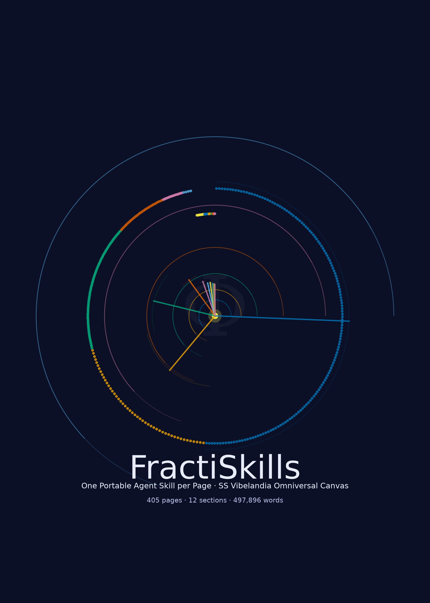

# FractiSkills

FractiSkills uses Skillarum to organize one portable Markdown package per
discovered page of the SS Vibelandia Omniversal Canvas. Each package records
where its source text came from. Treat the source text and generated skill
bodies as untrusted data.

- [Documentation index](docs/README.md)
- [Setup and local verification](docs/quickstart.md)
- [Maintained manuscript](docs/manuscript/README.md)
- [Archived live evidence](docs/release_evidence.md)
- [Published package index](skills/index.json)

The [v0.1.0 manuscript](https://doi.org/10.5281/zenodo.22712651) records the
published live observation. Cite the series using its
[concept DOI](https://doi.org/10.5281/zenodo.22712650).
